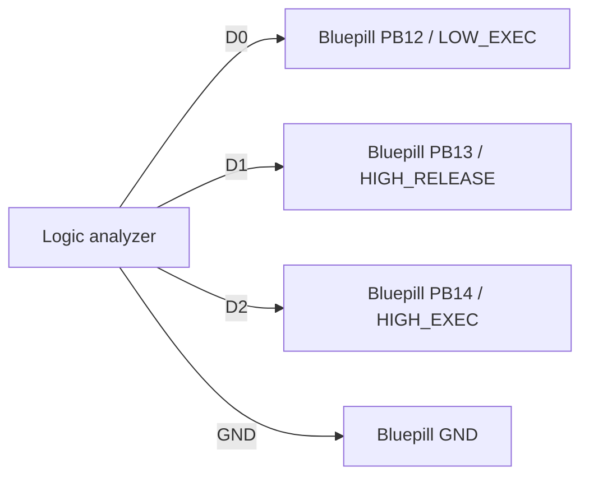

# ARM Cortex-M non-preemption example overview

This example demonstrates the bare-metal non-preemptive ARM Cortex-M port on the Bluepill target using a dummy application together with a remote logic analyzer capture.

The target application is a normal EDF executable. It instantiates two active objects receiving periodic published events with different priorities and blocking execution times. Each active object drives one GPIO high on entry and low on exit. A real `SysTick_Handler()` publishes the activation events and marks the higher-priority release on a third GPIO, and a second hardware timer provides the blocking execution delay used to keep the lower-priority active object active long enough to observe non-preemption on the logic analyzer.

The target executable can be flashed through GDB using the existing remote hardware gateway flow described in [Embedded target remote debugging](../../../../../../doc/development_methodology/software_domain/resources/embedded_target_remote_debugging.md). The resulting GPIO trace can then be inspected with the remote Sigrok and PulseView workflow described in [Embedded target remote logic analyzer](../../../../../../doc/development_methodology/resources/embedded_target_remote_logic_analyzer.md) in order to validate the scheduling behavior visually.

For the preemptive counterpart using the same three wires, see the [preemption example](arm_cortex_m_preemption_example.md). Both variants share the entry point, register definitions, TIM2 timer, and SysTick configuration under `examples/arm_cortex_m_example`; application behavior, trace GPIO implementation, and SysTick handlers remain variant-specific.

## Use case

- `AO_LOW`: priority 2, first release at 100 ms, period 1000 ms, blocking time 300 ms.
- `AO_HIGH`: priority 4, first release at 200 ms, period 1000 ms, blocking time 100 ms.

The phase offsets are chosen to start shortly after `t0` while still guaranteeing observable run-to-completion behavior:
- `AO_HIGH` becomes ready while `AO_LOW` is still active.
- `AO_HIGH` waits until `AO_LOW` returns rather than preempting it. IRQs remain enabled during the workload.

The execution budgets counted by the dummy application are:
- `AO_LOW`: 300 ms of elapsed workload time
- `AO_HIGH`: 100 ms of elapsed workload time

Over one aligned 1 second observation window, the workload-time totals are expected to be:
- `AO_LOW`: 300 ms
- `AO_HIGH`: 100 ms
- `Idle`: approximately 600 ms, excluding ISR and dispatch overhead

Timings are nominal at an 8 MHz core and TIM2 clock. Unlike the preemption example, TIM2 measures elapsed workload time including ISRs; no context-switch budget hook is used. SysTick publishes each activation event to its subscribed AO rather than driving EDF time events, and does not call `EDF_ISRExit()`.

This means the logic analyzer trace shows both:
- the elapsed workload budget consumed by each active object, visible on its `EXEC` signal
- the delay between the higher-priority release and execution, visible while the lower-priority handler runs to completion

## Wiring

Connect the logic analyzer as follows:

- `D0` -> `PB12` (`LOW_EXEC` trace)
- `D1` -> `PB13` (`HIGH_RELEASE` trace, not execution)
- `D2` -> `PB14` (`HIGH_EXEC` trace)
- Logic analyzer `GND` -> Bluepill `GND`

## Expected logic-analyzer behavior

When observed in Sigrok/PulseView, this example should show:
- `D0` / `PB12` starting first at approximately 100 ms and staying active until 400 ms.
- `D1` / `PB13` marking `AO_HIGH` release at approximately 200 ms, while `LOW_EXEC` is high. This pulse rises just after HIGH is queued and stays high until the next SysTick (about 1 ms); it does not mark execution.
- `D2` / `PB14` starting only after `LOW_EXEC` falls and `AO_LOW` returns, then staying active for approximately 100 ms. HIGH waits about 200 ms rather than preempting LOW.
- A visible run-to-completion sequence `AO_LOW -> AO_HIGH`, with no overlap between the two `EXEC` signals, repeating every 1000 ms.
- A total elapsed workload budget of approximately 400 ms per aligned 1 s observation window, leaving roughly 600 ms idle apart from ISR and dispatch overhead.

## Glossary

| Term | Definition |
|---|---|
| Elapsed workload time | Time budget measured by TIM2 during one AO's workload, including ISR time rather than counting only effective execution time. |
| Run-to-completion (RTC) | Scheduling in which the current AO handler returns before another AO is dispatched, even if a higher-priority AO becomes ready; IRQs can still run. |

## Usage example

- Configure and build the example using any of the target STM32F103C8Tx CMake presets.
- The target is selected for `stm32f103c8tx`, `EBF_CORE_BAREMETAL`, and `EBF_PORT_ARM_CORTEX_M_NON_PREEMPTIVE` (override the target presets' preemptive default with `-DEBF_PORT=EBF_PORT_ARM_CORTEX_M_NON_PREEMPTIVE`).
- Flash the resulting `arm_cortex_m_non_preemption_example` executable through the existing remote target workflow.
- Open the remote logic analyzer workflow and confirm that the waveforms match the expected run-to-completion pattern described above.
